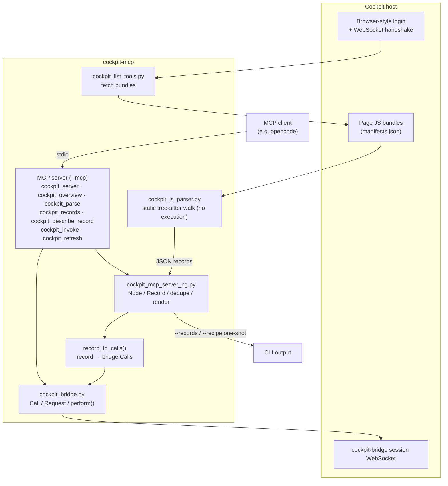

# cockpit-mcp — portable Cockpit bundle extractor + MCP server

This is more or less a vibe-coded project!

The idea is that the [Cockpit](https://www.cockpit-project.org/) project allows
structured access to a Linux host for administration. This means people have
curated which commands are sensible to run and which are not. An MCP server can
leverage this knowledge to help with system administration.

Unfortunately it turned out that the javascript bundles do not ship machine
readable actions like `add_user` but are just wrapped around `useradd`, which is
then executed on the host. So for an agent it doesn't make sense to call these
commands through the cockpit, it's better to call them directly over `ssh` and
the detection of available tools is better suited through a coding harness.

## Requirements

- Python 3.10+

## Installation

### From a GitHub release

Each [release](https://github.com/mslacken/cockpit-mcp/releases) ships a wheel.
Install it straight from the release asset (pulls in `mcp`, `tree-sitter`,
`tree-sitter-javascript`):

```sh
pip install https://github.com/mslacken/cockpit-mcp/releases/download/v0.1.1/cockpit_mcp-0.1.1-py3-none-any.whl
```

### From source

The project can be packaged and installed from a wheel:

```sh
# build the wheel
python -m build            # -> dist/cockpit_mcp-0.1.2-py3-none-any.whl
# or: pip wheel . -w dist/

# install it (pulls in mcp, tree-sitter, tree-sitter-javascript)
pip install dist/cockpit_mcp-*.whl
# or, straight from the source tree:
pip install .
```

This installs four top-level modules plus console scripts: `cockpit-mcp`,
`cockpit-bridge`, `cockpit-js-parser`, `cockpit-list-tools`. (For local/manual
use you can also just `pip install -r requirements.txt` and run the `.py` files
directly as before.)

## Usage

```sh
cockpit-mcp --records --bundle /path/page.js
cockpit-mcp --fetch --insecure https://host:9090 --into /tmp/live
cockpit-mcp --mcp --bundle /path/page.js     # serve over stdio
cockpit-mcp --version
```

### MCP client config (stdio)

```json
{
  "mcpServers": {
    "cockpit": {
      "command": "cockpit-mcp",
      "args": ["--mcp", "--bundle", "/path/page.js"]
    }
  }
}
```


## How it works

The project is a multi-program pipeline implementing access to a Cockpit server:

1. **Fetch** — `cockpit_list_tools.py` talks to a running Cockpit host the way
   a browser does (login, WebSocket handshake, `manifests.json`) and
   downloads the page JavaScript bundles.
2. **Parse** — instead of executing the bundles, `cockpit_js_parser.py`
   (python-tree-sitter + `tree-sitter-javascript`) statically
   walks the syntax tree and recovers every bridge-mutating call site
   (`cockpit.spawn`, dbus calls, proxy calls, file writes) as a JSON record.
3. **Model** — `cockpit_mcp_server_ng.py` ingests those records, models them
   (`Node`/`Record` classes), dedupes them, and renders them per the record
   format.
4. **Bridge** — `record_to_calls()` maps each record to concrete
   `cockpit_bridge.Call` objects; `cockpit_bridge.py` performs them over
   the cockpit-bridge session WebSocket directly — no browser needed.
5. **Serve** — the CLI exposes the pipeline one-shot (`--records`, `--recipe`),
   and `--mcp` serves the same functions as MCP tools
   (`cockpit_server`, `cockpit_overview`, `cockpit_parse`, `cockpit_records`,
   `cockpit_describe_record`, `cockpit_invoke`, `cockpit_refresh`). Plans
   that may change the host are shown first and only run with `confirm=true`.

`cockpit_bridge.py` is optional: parsing and record listing work without it;
only `cockpit_invoke` needs a live bridge connection.

### Why statically parse the JavaScript instead of shipping recipes?

The earlier revision of this project did the opposite: an *adapter* (recipe)
table hand-written in Python, one entry per catalog action, mapping each action
name to the exact `cockpit.spawn` / dbus calls its dialog performs. That was
replaced by statically walking the page bundles. The reasons:

- **It scales to every package, not a curated list.** A recipe table only knows
  the actions its author bothered to transcribe — an account dialog here, a
  partition dialog there. Everything else is "no recipe" and `cockpit_invoke`
  refuses it. Static parsing recovers the bridge-mutating calls of *every*
  bundle the host ships, including packages this project has never seen, so the
  server's coverage is bounded by what Cockpit ships, not by its own TODO list.
- **It stays in sync for free.** A recipe is a second, out-of-band copy of logic
  that lives in the page; when a Cockpit package changes its command line, its
  argument order, its dbus interface or its privilege flags, the recipe now
  silently builds the *wrong* call. Parsing reads the source of truth directly,
  so a Cockpit update can neither break nor quietly corrupt an action — the
  extracted record is always built from the JavaScript the host would actually
  run.
- **It captures privilege and arguments correctly.** Every record carries the
  `superuser` requirement, the stdin payload and the exact argv the page composes
  (including values that are computed, not literals), which a flat recipe table
  tends to approximate by hand. `cockpit_describe_record` can then show a caller
  a real argv and flag `confirm` only for the calls that truly modify the host.
- **It is one less moving part to maintain.** No per-action Python to write,
  review, or keep in lockstep across Cockpit versions. The parser is generic;
  the per-action knowledge stays where it belongs — in Cockpit's own curated
  pages.

The trade-off is honesty, not capability: you see what the page *does*, not what
a person decided was sensible. Cockpit already curates *which* dialogs exist and
*how* they invoke the bridge; the parser just extracts that intent rather than
re-encoding it.



## Contents

| File | Description |
|---|---|
| `cockpit_mcp_server_ng.py` | Main entry point (CLI + MCP server) |
| `cockpit_bridge.py` | Bridge backend (`Call`/`Request`/`perform`) |
| `cockpit_list_tools.py` | Host connect / asset fetch (stdlib only) |
| `cockpit_js_parser.py` | Bundle parser (tree-sitter, in process) |
| `requirements.txt` | Python deps |

## Notes

- Optional modules degrade gracefully: without `cockpit_bridge.py`, the
  `invoke` tool reports an error; parsing and records still work.
