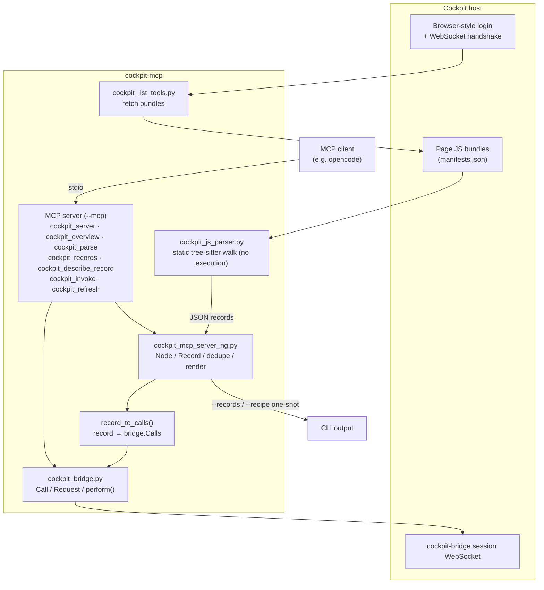

# cockpit-mcp — portable Cockpit bundle extractor + MCP server

This is more or less a vibe-coded project!

The idea is that the [Cockpit](https://www.cockpit-project.org/) project allows
structured access to a Linux host for administration. This means people have
curated which commands are sensible to run and which are not. An MCP server can
leverage this knowledge to help with system administration.

## How it works

The project is a multi-program pipeline implementing access to a Cockpit server:

1. **Fetch** — `cockpit_list_tools.py` talks to a running Cockpit host the way
   a browser does (login, WebSocket handshake, `manifests.json`) and
   downloads the page JavaScript bundles.
2. **Parse** — instead of executing the bundles, `cockpit_js_parser.py`
   (python-tree-sitter + `tree-sitter-javascript`) statically
   walks the syntax tree and recovers every bridge-mutating call site
   (`cockpit.spawn`, dbus calls, proxy calls, file writes) as a JSON record.
3. **Model** — `cockpit_mcp_server_ng.py` ingests those records, models them
   (`Node`/`Record` classes), dedupes them, and renders them per the record
   format.
4. **Bridge** — `record_to_calls()` maps each record to concrete
   `cockpit_bridge.Call` objects; `cockpit_bridge.py` performs them over
   the cockpit-bridge session WebSocket directly — no browser needed.
5. **Serve** — the CLI exposes the pipeline one-shot (`--records`, `--recipe`),
   and `--mcp` serves the same functions as MCP tools
   (`cockpit_server`, `cockpit_overview`, `cockpit_parse`, `cockpit_records`,
   `cockpit_describe_record`, `cockpit_invoke`, `cockpit_refresh`). Plans
   that may change the host are shown first and only run with `confirm=true`.

`cockpit_bridge.py` is optional: parsing and record listing work without it;
only `cockpit_invoke` needs a live bridge connection.



## Contents

| File | Description |
|---|---|
| `cockpit_mcp_server_ng.py` | Main entry point (CLI + MCP server) |
| `cockpit_bridge.py` | Bridge backend (`Call`/`Request`/`perform`) |
| `cockpit_list_tools.py` | Host connect / asset fetch (stdlib only) |
| `cockpit_js_parser.py` | Bundle parser (tree-sitter, in process) |
| `requirements.txt` | Python deps |

## Requirements

- Python 3.10+
- `pip install -r requirements.txt`

## Usage

```sh
./cockpit_mcp_server_ng.py --records --bundle /path/page.js
./cockpit_mcp_server_ng.py --fetch --insecure https://host:9090 --into /tmp/live
./cockpit_mcp_server_ng.py --mcp --bundle /path/page.js     # serve over stdio
./cockpit_mcp_server_ng.py --version
```

### MCP client config (stdio)

```json
{
  "mcpServers": {
    "cockpit": {
      "command": "python3",
      "args": ["/path/to/cockpit-mcp/cockpit_mcp_server_ng.py", "--mcp",
               "--bundle", "/path/page.js"]
    }
  }
}
```

## Notes

- Optional modules degrade gracefully: without `cockpit_bridge.py`, the
  `invoke` tool reports an error; parsing and records still work.
